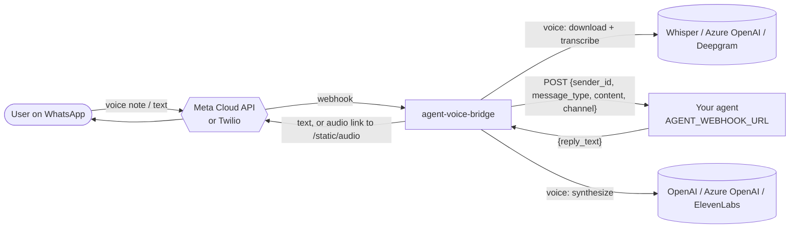

<div align="center">

# agent-voice-bridge

**Turn any AI agent into a WhatsApp voice & chat agent — in five minutes.**

Backed by [Denegra](https://denegra.com) — Enterprise AI Agents & Workflow Automation

[](https://github.com/denegra-ai/agent-voice-bridge/actions/workflows/ci.yml)


</div>

---

`agent-voice-bridge` is a small, async FastAPI gateway that sits between messaging channels
(**WhatsApp Cloud API** and **Twilio**) and **your** AI agent. It normalises every inbound
message, posts it to one HTTP endpoint you own, and sends the answer back on the same channel —
**as a voice note if the user spoke, as text if the user typed.**

It contains **no agent logic**. Your brain stays where it is — LangGraph, CrewAI, n8n, a
Lambda, a plain Flask app. The bridge only does the plumbing: webhooks, signatures, media
download, speech-to-text, text-to-speech, and delivery.

## How it works



| User sends   | Bridge does                                   | User receives |
|--------------|-----------------------------------------------|---------------|
| Text         | text → agent                                  | Text          |
| Voice note   | download → transcribe → agent → TTS → host    | Voice note    |

Webhooks are acknowledged immediately (`200` for Meta, empty TwiML for Twilio); the slow
work runs in the background and the reply is sent through the provider's REST API. That keeps
you inside Meta's and Twilio's webhook timeouts even when your agent takes 20 seconds to think.

## Why use it?

- **Bring your own agent.** Anything that answers an HTTP POST works: a LangGraph server, a
  CrewAI flow behind FastAPI, an n8n *Webhook → Respond to Webhook* workflow, or a custom API.
- **Voice in, voice out.** Users who speak get spoken answers. No extra code in your agent.
- **One contract, two channels.** Your agent never sees Meta or Twilio payloads.
- **Production basics built in.** Signature verification on both channels, webhook dedupe,
  agent retries with backoff (only where a retry is safe), TTS-to-text fallback, health check,
  non-root container.
- **Small.** Under 800 lines of Python, six runtime dependencies, no database.

## The agent contract

The bridge sends:

```http
POST $AGENT_WEBHOOK_URL
Authorization: Bearer $AGENT_AUTH_TOKEN   # only if set
Content-Type: application/json

{
  "sender_id": "905551112233",
  "message_type": "voice",
  "content": "What time does the store open tomorrow?",
  "channel": "meta"
}
```

Your agent answers:

```json
{ "reply_text": "We open at 9 am tomorrow." }
```

An empty `reply_text` sends nothing. `sender_id` is the WhatsApp number for Meta and the
Twilio `From` value (for example `whatsapp:+905551112233`) for Twilio — use it as your
conversation/session key.

A complete echo agent for testing:

```python
# echo_agent.py — run with: uvicorn echo_agent:app --port 9000
from fastapi import FastAPI

app = FastAPI()


@app.post("/agent")
async def agent(msg: dict) -> dict:
    return {"reply_text": f"You said ({msg['message_type']}): {msg['content']}"}
```

## Quickstart (Docker, ~3 minutes)

**Prerequisites:** Docker, an OpenAI API key (or an Azure OpenAI resource), and either a Meta
WhatsApp Cloud API app or a Twilio account (the Twilio WhatsApp Sandbox is fine for testing). For
local testing you also need a public HTTPS tunnel such as [ngrok](https://ngrok.com).

**1. Configure with your own keys**

```bash
git clone https://github.com/denegra-ai/agent-voice-bridge.git && cd agent-voice-bridge
python3 scripts/configure.py
```

The setup wizard asks only what your choices need: your agent URL, your public URL, which
channel (Meta and/or Twilio) and which speech providers. Keys are typed hidden, checked against
the real service before anything is saved, and written to `.env` (readable only by you). It ends
by printing the webhook URLs to paste into Meta or Twilio. Re-run it any time to change a value;
pressing Enter keeps what is already there.

Prefer editing by hand? `cp .env.example .env` — every variable is documented in the file. The
service refuses to start and names the missing variable if something required is absent.

**2. Run**

```bash
docker compose up -d --build
ngrok http 8000
curl http://localhost:8000/health   # {"status":"ok","version":"0.1.1","channels":["meta"]}
```

**3. Point the channel at the bridge**

- **Meta:** App Dashboard → Use cases → WhatsApp → Customize → Step 2. Production setup →
  Configure Webhooks. Callback URL `https://<your-tunnel>/webhook/meta`, Verify token =
  `META_VERIFY_TOKEN`. Click *Verify and save*, then subscribe to the **messages** field.
- **Twilio:** Console → Messaging → WhatsApp Sandbox (or your sender) →
  *When a message comes in* = `https://<your-tunnel>/webhook/twilio`, method `POST`.

Send a text, then a voice note. Done.

First time with Meta or Twilio? The step-by-step guides cover accounts, test numbers, tokens
and common errors: [Meta WhatsApp Cloud API setup](docs/meta-setup.md) ·
[Twilio WhatsApp setup](docs/twilio-setup.md).

### Without Docker

```bash
uv sync
uv run uvicorn app.main:create_app --factory --port 8000
```

## Configuration

Every option is documented in [`.env.example`](.env.example). The most important ones:

| Variable | Default | Purpose |
|---|---|---|
| `AGENT_WEBHOOK_URL` | — | Your agent endpoint (required) |
| `PUBLIC_BASE_URL` | — | Public HTTPS URL of this service (required) |
| `STT_PROVIDER` | `openai` | `openai` (Whisper), `azure` (Azure OpenAI) or `deepgram` |
| `TTS_PROVIDER` | `openai` | `openai` / `azure` (Ogg/Opus voice note) or `elevenlabs` (MP3) |
| `AGENT_TIMEOUT_SECONDS` | `30` | Per-attempt agent timeout |
| `AGENT_MAX_RETRIES` | `2` | Retries on connect errors and 429/502/503/504 |
| `AUDIO_TTL_SECONDS` | `3600` | Generated audio is deleted after this |
| `FALLBACK_REPLY_TEXT` | empty | Sent when transcription or the agent fails |

## Operational notes

- **Security.** Meta requests are checked against `X-Hub-Signature-256` (`META_APP_SECRET`),
  Twilio requests against `X-Twilio-Signature` (`TWILIO_AUTH_TOKEN` + `PUBLIC_BASE_URL`).
  Unsigned or mis-signed requests get `403`. Message content is never logged.
- **Generated audio** is public at an unguessable URL (`/static/audio/<uuid>.ogg`) so the
  provider can fetch it, and is deleted after `AUDIO_TTL_SECONDS`.
- **Retries.** The agent call is retried only when the agent cannot have processed the
  message (connection failure, 429/502/503/504). A `500` or a read timeout is not retried, so
  your agent never answers the same message twice because of the bridge.
- **Voice note vs. audio file.** OpenAI and Azure OpenAI TTS produce Ogg/Opus, which WhatsApp
  plays as a voice note. ElevenLabs output is MP3 and shows up as an audio attachment.
- **Scaling.** Webhook dedupe is in-memory, so run one process per instance (the default).
  For horizontal scaling put a shared store in front of `is_duplicate` and serve audio from
  object storage.

## Development

```bash
uv sync
uv run pytest
uv run ruff check . && uv run ruff format --check .
```

Tests mock every external API with `httpx.MockTransport` — no keys or network needed.

---

### 🏢 Need Enterprise SLA, Custom CRM Integration, or Dedicated Hosting?

We build and deploy resilient, high-volume AI voice & chat pipelines integrated with internal
enterprise infrastructure, custom LLMs, and ERP/CRM systems.

📩 Contact: info@denegra.ai | [Book an Architecture Call](https://denegra.com)

---

## License

[Apache License 2.0](LICENSE) — free for commercial use.

## Legal disclaimer

This project is an independent open-source project and is **not affiliated with, endorsed by,
or sponsored by** Meta Platforms, Inc., WhatsApp LLC, Twilio Inc., OpenAI, Deepgram, or
ElevenLabs. "WhatsApp" and "Meta" are trademarks of Meta Platforms, Inc.; "Twilio" is a
trademark of Twilio Inc.; all other product names are trademarks of their respective owners
and are used here only to describe compatibility. You are responsible for complying with each
provider's terms of service, messaging policies and applicable data-protection law (e.g. GDPR,
KVKK) when you deploy this software.
